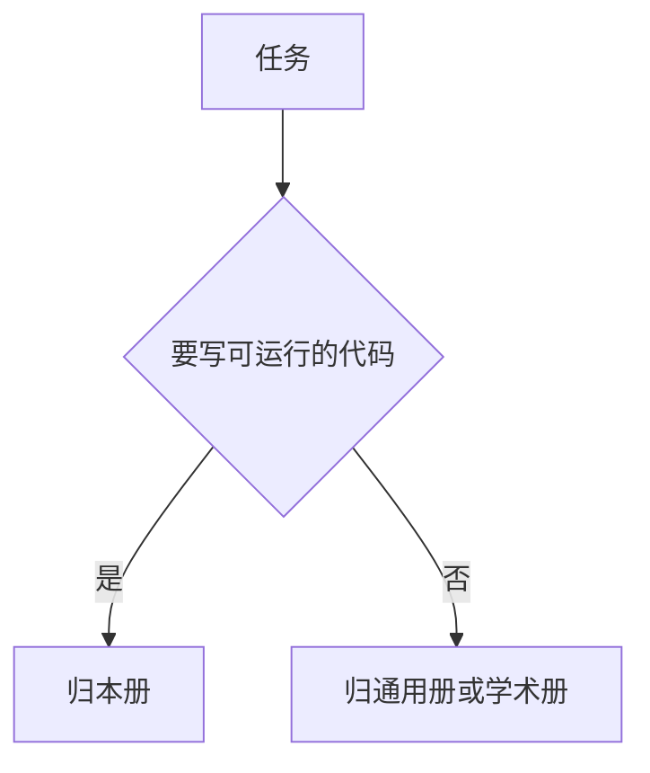

# 编程使用说明

> **来源**：2026-10-19 从 `开题报告/` 沿用模板初始化；2026-10-24 首次按 R8 归册 2 条失误（见《索引》第六节）
> **编写原则**：只收录**实际验证过**的事实、命令、报错原文与结论；未验证一律标注「未验证」，不写成通用结论
> **通用化说明（R7）**：每条内容按「**可迁移的规则** + 本次实测（证据）+ 使用条件」组织；**实例可替换，规则不变**。**遮住法自检**：把「本次 / 实测」等词所在的句子整句删掉，若这一节**不再剩下可执行的指示**，说明它只是操作记录，需改写成规则（见《索引》4.1）
> **配套文件**：《使用说明_索引与归纳规则.md》（归属判定与硬规则 R1–R8）、《_AI失误台账.md》（原始流水）
> **核心纪律**：**预测运行结果前必须先实跑；规范文档只能有一处权威定义**
> **修订记录**：① 2026-10-19 初始化模板；② 2026-10-24 归册 2 条失误（验证纪律、规范一致性），补齐第 0/1/2/3 章与附录 A
>
> **怎么读本册（省时间）**：**先查《索引》第二节**定位到具体小节，**不要通读**。读一节时——**「规则句」必须读**（含 应 / 须 / 不要 / 判据 / 做法 / 步骤 的句子），**「本次实测」是证据、可略读**；**「使用条件」决定这条适不适用于你当前的情况**。

---

# 第 0 章　适用判定

## 0.1 判断流程图

**规则**：判断一个任务是否落入本册，看它是否**要写出可运行的代码**（脚本、notebook、函数、命令）。

## 0.2 一票否决项（任一不满足，对应功能**不可用**）

**规则**：出现下列任一情况时，**不要硬追求「能跑」**，先解决环境问题并明确告知用户「做不到」。

| 否决项 | 原因 |
|---|---|
| 解释器版本与依赖要求冲突 | 例如 scipy 1.16+ 要求 Python 3.11+，而项目是 3.10，升级这条路走不通 |
| 依赖二进制与操作系统不兼容 | 例如 macOS 27 上 scipy 1.15.3 报 `__thread_bss` 加载错误 |

## 0.3 一句话总则

**规则**：**能实跑验证的结论才算结论；规范文档里同一件事只能有一个说法。**

---

# 第 1 章　适用条件

**适用**：Python 编程教学、脚本撰写、依赖排错、代码规范制定。

**不适用 / 必须拒绝**：生产级部署、多机分布式、安全审计等超出本项目目标的场景。

---

# 第 2 章　基础环境

## 2.1 环境基线

**规则**：在本项目里跑任何 Python 代码，统一用项目内的虚拟环境解释器，不要用系统 Python。

**本次实测**：`/Users/pipizhengkai/ai-d1/.venv/bin/python`（Python 3.10.11），依赖含 torch、transformers、faiss-cpu、pypdf、requests、python-dotenv。

**使用条件**：

| 条件 | 说明 |
|---|---|
| 适用于 | 本机 ai-d1 项目 |
| **不适用** | 换机器或重建虚拟环境时，需重新核对版本与依赖 |

## 2.2 验证纪律：先跑再说

**规则**：给出任何「运行结果类断言」（会变多 / 会变少 / 已生效 / 已完成 / 已排除）之前，必须先在本地实跑一次并核对输出；不得凭直觉、类比或推理直接下结论。

**本次实测**：断言「`重叠=0` 时切分段数会变少」；实跑 `按段落切(文本, 每段字数=500, 重叠=0)` 得到 **11 段**，与 `重叠=50` 的 11 段相同 —— 重叠只改变边界内容，不改变段数。

**使用条件**：

| 条件 | 说明 |
|---|---|
| 适用于 | 所有预测代码行为的场景，含「改了参数会怎样」 |
| **不适用** | 可用数学严格证明的复杂度或正确性陈述（如「两重循环是 O(n²)」） |

## 2.3 规范一致性：单一权威定义

**规则**：同一规范只能有一处权威定义；写入量化指标（如覆盖率百分比）时，必须与同节的定性要求一致；发现矛盾立即统一，并标注修订日期。

**本次实测**：`代码讲解格式.md` 同时存在「每一行都要有注释」（100%）与「覆盖率 40% 以上」两条；按 40% 执行导致 `d06_embedding.py`、`d07_load_split.py`、`embed_helper.py` 大段裸代码。已改为 **100%** 并标注 2026-10-23 修订。

**使用条件**：

| 条件 | 说明 |
|---|---|
| 适用于 | 任何规范、模板、检查清单文档 |
| **不适用** | 一次性的口头约定（未落成文档） |

---

# 第 3 章　编程册排错速查

**规则**：遇到下列症状，先按本表定位根因，再处理。

| 症状 / 报错原文 | 根因 | 处理 |
|---|---|---|
| 预测「改了参数结果会变」，实跑没变 | 未实测就断言 | 见 2.2：先跑一次再下结论 |
| 同一份规范里两条要求互相矛盾 | 多处定义 | 见 2.3：统一成一处并标注修订日期 |
| `dlopen(...) section '__DATA/__thread_bss'` | scipy 1.15.3 与 macOS 27 不兼容 | 用 sys.modules 桩模块绕过，见 `embed_helper.py` |
| `OMP: Error #15 ... libomp.dylib already initialized` | torch 与 faiss 各带一份 OpenMP | 设 `KMP_DUPLICATE_LIB_OK=TRUE` |

---

# 附录 A　条件矩阵（一页速查）

| 情形 | 结论 | 见哪节 |
|---|---|---|
| 要写或改代码 | 用项目 venv 解释器 | 2.1 |
| 想说「这样改会更快 / 更多 / 生效了」 | 先实跑验证 | 2.2 |
| 规范文档要求冲突 | 统一为一处 | 2.3 |
| 依赖报二进制加载错误 | 查排错速查 | 第 3 章 |
